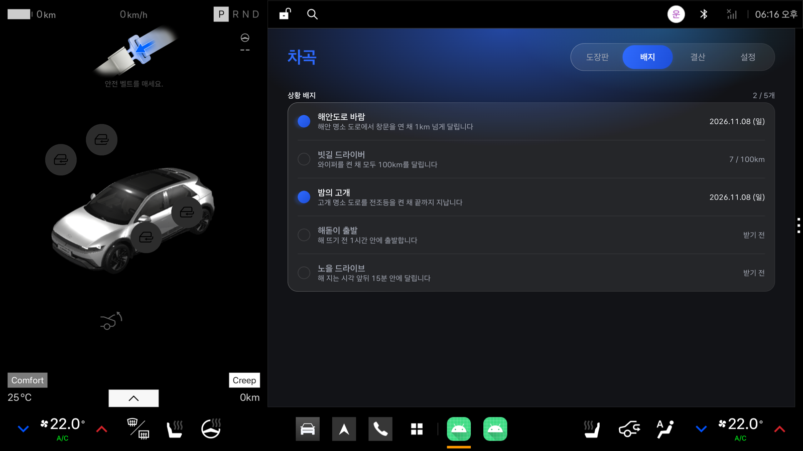
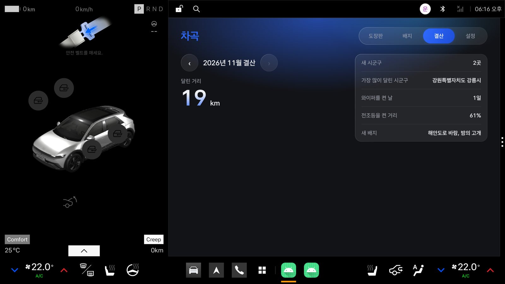
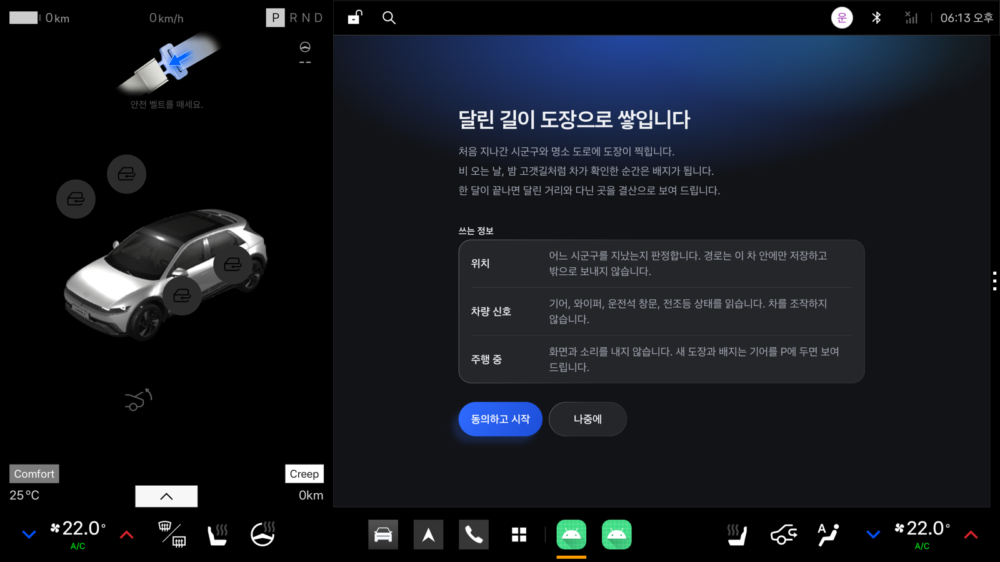
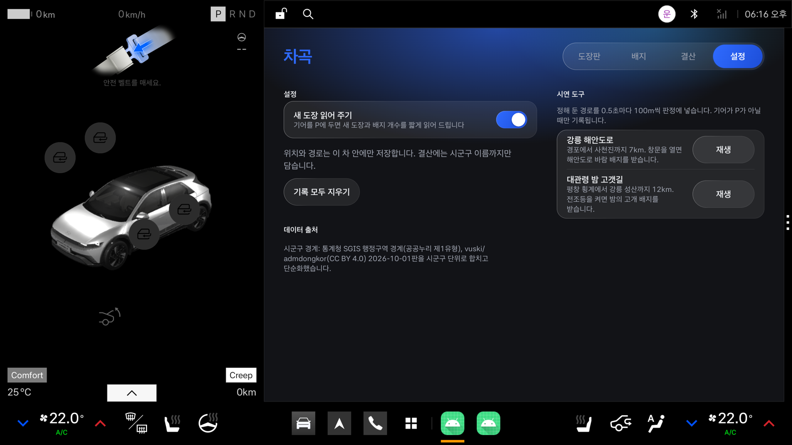
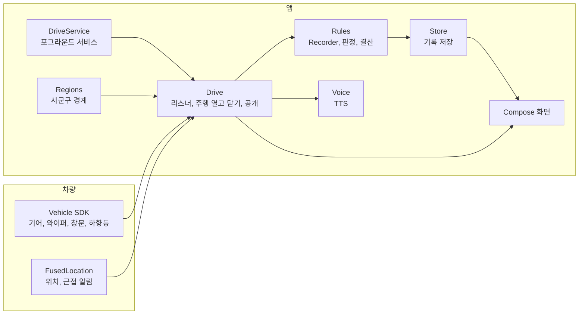

<div align="center">

# 차곡

**내 차로 다닌 곳과 순간이 쌓이는 드라이브 도감**

현대차와 기아의 Pleos Connect 차량용 앱 | 현대차그룹 차량용 앱 개발 공모전 출품작


[시연 영상](.github/readme/demo.mp4) | [설치와 실행](#설치와-실행) | [시연 순서](#시연-순서)

<br>


<sub>Pleos Connect 에뮬레이터 v2.1.0에서 녹화했습니다. 출발 15초와 정차 앞뒤 18초를 이어 붙였습니다.</sub>

</div>

<br>

## 요약

차곡은 차로 처음 지나간 시군구에 도장을 찍어 전국 지도를 채우는 Pleos Connect 앱입니다. 같은 길이라도 해안도로에서 창문을 열고 달리거나 밤 고갯길을 전조등을 켜고 넘으면, 차가 그 순간을 확인해 배지로 남깁니다. 한 달이 끝나면 달린 거리, 새 시군구, 와이퍼를 켠 날을 차 데이터로 결산합니다.

운전자에게 무엇을 하라고 시키지 않습니다. 주행 중에는 "주행 기록 중" 한 줄만 보이고, 새 도장과 배지는 기어를 P에 둔 뒤에 한 번 보여 줍니다.

| 항목 | 내용 |
|---|---|
| 한 줄 소개 | 내 차로 다닌 곳과 순간이 쌓이는 드라이브 도감 |
| 주 사용자 | 드라이브와 여행을 즐기는 20~40대 운전자 |
| 함께 쓰는 사람 | 매일 같은 길을 달리는 출퇴근 운전자 |
| 화면 | 7개 (동의, 주행 중, 정차 후 공개, 도장판, 배지, 결산, 설정) |
| 판정 | 시군구 도장 256곳, 명소 도로 도장 8곳, 상황 배지 5종, 월간 결산 |
| 사용 SDK | Pleos Vehicle, FusedLocation, TextToSpeech |
| 저장 | 기기 안 파일 두 개. 서버 없이 동작합니다 |
| 검증 | 단위 테스트 16건 통과, 에뮬레이터에서 경로 재생 2회와 `geo fix` 주행 1회 |

<br>

## 문제 정의

국내 여행의 84.5%가 자가용으로 갑니다. 그런데 차로 다닌 기록은 어디에도 남지 않습니다. 내비 앱은 이동 통계만 보여 주고, 차량 월간 리포트는 이메일로 오는 주행 정보에 그칩니다.

지역은 반대의 고민을 합니다. 방문객을 부르려고 스탬프 투어와 지역화폐 보상에 예산을 쓰지만, 폰 GPS 스탬프는 실제로 차를 타고 왔는지 증명하지 못합니다.

| 항목 | 값 | 출처 |
|---|---|---|
| 국내여행 교통수단 중 자가용 | 84.5% | 2025 국민여행조사, 세계일보 2026-06-30 |
| 국내여행 횟수 | 약 3억 900만 회, 1인당 6.5회 | 위와 같음 |
| 디지털 관광주민증(경북) | 발급 122만 1,064건, 이용 3만 5,878건 | 뉴시스 2026-07-11 |
| 지자체 스탬프 보상 | 구미 8곳 인증 시 지역화폐 최대 2만 원, 남양주 최대 4만 원 | 텔트립, 헤럴드K |
| Spotify Wrapped 2025 | 첫날 이용자 2억 명 이상, 공유 5억 회 이상 | TechCrunch 2025-12-04 |

<br>

## 차별점

스탬프 모으기, 방문 지도, 연말 결산 카드는 이미 흔합니다. 차곡은 이 셋을 새로 만들었다고 말하지 않습니다. 폰 앱으로는 만들 수 없는 두 가지에 집중합니다.

| 이미 흔한 것 | 차곡이 다른 점 |
|---|---|
| 폰 GPS 자동 스탬프 | 기어가 P가 아닐 때만 인정합니다. 걸어서 지나가면 찍히지 않습니다 |
| 장소 체크인 배지 | 와이퍼, 창문, 전조등, 기어 같은 차 신호로 그 순간을 확인합니다 |
| 여행 결산 카드 | 와이퍼를 켠 날, 전조등을 켠 거리처럼 차 데이터로 만든 결산입니다 |

<br>

## 주요 기능

### 주행 중에는 한 줄만


기어가 P에서 벗어나면 화면은 전환 효과 없이 "주행 기록 중" 한 줄로 바뀌고 모든 모션이 멈춥니다. 소리도 내지 않습니다. 도장과 배지 판정은 화면과 상관없이 포그라운드 서비스에서 계속 돌아갑니다. 다른 앱을 앞에 띄워도 위치와 차량 신호가 끊기지 않습니다.

### 정차 후 공개


기어를 P에 두고 3초가 지나면 이번 주행에서 새로 받은 도장과 배지를 목록으로 한 번 보여 줍니다. "새 도장 2개, 배지 1개를 모았습니다"처럼 짧게 읽어 주고, 설정에서 끌 수 있습니다. 새로 받은 것이 없으면 아무것도 띄우지 않습니다.

### 전국 도장판


전국 256개 시군구를 지도에 그리고 도장을 받은 곳을 칠합니다. 오른쪽에는 도별 진행률, 명소 도로 진행률, 도장 기록 목록이 있습니다. 시 아래 구(수원시 장안구 등)는 따로 셉니다.

### 상황 배지



받은 배지는 받은 날짜를, 잠긴 배지는 조건을 보여 줍니다. 누적 조건이 있는 빗길 드라이버는 진행 거리(예: 19 / 100km)를 함께 보여 줍니다.

### 월간 결산



달마다 달린 거리, 새 시군구 수, 가장 많이 달린 시군구, 와이퍼를 켠 날, 전조등을 켠 거리 비율, 새 배지를 모읍니다. 화살표로 지난달 결산도 볼 수 있습니다.

### 동의와 설정

| 동의 | 설정 |
|---|---|
|  |  |
| 처음 실행하면 무엇이 쌓이는지 세 줄과 쓰는 정보(위치, 차량 신호, 주행 중 동작)를 보여 줍니다. "동의하고 시작"을 눌러야만 기록을 시작합니다. | 읽어 주기를 끌 수 있고, 기록은 두 번 눌러야 지워집니다. 시군구 경계 데이터의 출처를 밝히고, 시연 도구로 정해 둔 경로를 재생합니다. |

<br>

## 도장과 배지 규칙

모든 판정은 기어가 P가 아닌 동안의 주행에서만 합니다.

| 코드 | 이름 | 조건 | 쓰는 신호 |
|---|---|---|---|
| D-01 | 시군구 도장 | 한 번의 주행에서 같은 시군구 안을 500m 이상 달림 | FusedLocation 위치, 기어 |
| D-02 | 명소 도로 도장 | 구간 시작점과 끝점(반경 300m)을 순서대로 지남 | FusedLocation 근접 알림 |
| B-01 | 해안도로 바람 | 해안 명소 구간에서 운전석 창문을 연 채 1km 이상 | 창문 위치(0~10, 1 이상이면 열림) |
| B-02 | 빗길 드라이버 | 와이퍼를 켠 채 달린 거리 누적 100km | 앞 와이퍼 상태 |
| B-03 | 밤의 고개 | 고개 명소 구간을 시작부터 끝까지 전조등을 켠 채 지남 | 하향등 상태 |
| B-04 | 해돋이 출발 | 해 뜨기 전 1시간 안에 출발 | 기어, 일출 시각 |
| B-05 | 노을 드라이브 | 해 지는 시각 앞뒤 15분 안에 주행 | 위치, 일몰 시각 |

일출과 일몰 시각은 위도, 경도와 날짜로 기기 안에서 계산합니다. 1초 사이에 1km 넘게 움직인 위치는 잘못 들어온 값으로 보고 거리에 넣지 않습니다.

| 명소 도로 | 종류 |
|---|---|
| 강릉 해안도로, 헌화로, 달맞이길, 애월 해안도로, 물미해안도로 | 해안 |
| 대관령 옛길, 미시령 옛길, 한계령 | 고개 |

<br>

## 안전 설계

공모전이 안내한 Pleos 개발자 가이드의 주행 중 동작 기준을 먼저 정하고 화면을 그렸습니다. 왼쪽은 가이드 기준, 오른쪽은 차곡의 구현입니다.

| 가이드 기준 | 구현 |
|---|---|
| 주행 중 1~2초 안에 파악, 애니메이션 금지 | 기어가 P에서 벗어나면 전환 효과 없이 한 줄 화면으로 바꾸고 앱 전체의 모션을 끕니다 |
| 운전에 필요한 알림만 | 주행 중에는 소리와 화면 변화가 없습니다. 공개는 기어 P 3초 뒤 한 번입니다 |
| 오디오 포커스 | 읽어 주기는 `GAIN_TRANSIENT_MAY_DUCK`으로 포커스를 받아 내비 안내와 겹치지 않게 합니다 |
| 운전자에게 행동을 유도하지 않음 | 배지는 조건을 채우라고 알리지 않습니다. 평소처럼 달린 결과를 나중에 보여 줄 뿐입니다 |
| 대비 4.5:1 이상 | 본문 16.4:1, 보조 글자 5.9:1 (밝은 테마), 본문 13.3:1, 보조 글자 6.4:1 (어두운 테마 유리 판 위), 파란 빛 위 흰 글자 4.5:1 이상 |
| 한 손 조작 | 누르는 영역은 모두 88dp 이상입니다 |
| CCP 미지원 선언, Back은 `moveTaskToBack` | 매니페스트에 `ROTARY_SUPPORTED=false`를 선언했고, 뒤로 가기는 앱을 닫지 않고 뒤로 보냅니다 |
| 위치 사용은 명시적 동의 | "동의하고 시작" 버튼으로만 동의하고, 그 뒤에 FusedLocation 권한을 요청합니다 |

<br>

## 개인정보

| 원칙 | 구현 |
|---|---|
| 기기 안에만 저장 | 위치, 경로, 차량 신호는 앱 내부 파일에만 저장하고 서버로 보내지 않습니다 |
| 필요한 만큼만 저장 | 좌표는 판정 뒤 버리고, 주행마다 시군구별 거리와 신호별 거리만 남깁니다 |
| 공유는 시군구 단위 | 결산에는 시군구 이름까지만 담습니다. 경로와 시각은 담지 않습니다 |
| 지울 권리 | 설정 탭에서 기록을 모두 지울 수 있습니다 |
| 읽기 권한만 | 차량 권한은 기어, 창문, 전조등을 읽는 권한뿐이고 차를 조작하지 않습니다 |

<br>

## 디자인

밤에 달리는 차 안을 떠올려 어두운 바탕 위에 파란 빛 하나만 씁니다(`ui/Theme.kt`). 화면 위쪽에는 파란 불빛이 은은하게 번지고, 탭과 버튼과 목록은 반투명 유리 판 위에 올립니다. 유리 판은 왼쪽 위 테두리가 빛을 받은 듯 밝고, 아래로 갈수록 옅어집니다. 받은 도장, 고른 탭, 켠 스위치, 주 버튼은 밝은 파랑에서 짙은 파랑으로 흐르는 빛으로 칠하고 같은 색 그림자로 번지게 합니다. 받기 전 배지는 선으로만 그립니다.

Apple Liquid Glass와 Material 3 Expressive 가이드를 참고해 원칙 두 가지를 지켰습니다. 유리는 조작부와 목록 판에만 쓰고 유리 위에 유리를 겹치지 않습니다. 움직임은 눌렀다는 것과 무엇이 어디로 갔는지를 알릴 때만 쓰고, 화면 불빛은 움직이지 않습니다.

| 토큰 | 밝은 테마 | 어두운 테마 |
|---|---|---|
| 배경 | `#F4F5F9` | `#121317` |
| 유리 판 | 흰색 70% | 흰색 8% |
| 본문 | `#16171B` | `#EEF0F3` |
| 보조 글자 | `#5B5F6B` | `#A3A8B4` |
| 강조 빛 | `#2F6BFF` → `#1D4ED8` | 같음 |

글자 크기는 1~2초 안에 읽히도록 차량용(본문 28sp)으로 키웠습니다. 큰 숫자는 위에서 아래로 파란 빛이 섞이게 칠합니다. 한국어는 낱말 단위로 줄을 바꿉니다.

| 모션 | 쓰는 곳 |
|---|---|
| 스프링 눌림 | 버튼과 탭을 누르면 95%로 살짝 눌렸다가 튕기며 돌아옵니다. 짧은 진동도 함께 줍니다 |
| 손끝 불빛 | 누른 자리에서 빛이 번졌다가 손을 떼면 0.3초 동안 사라집니다 |
| 미끄러지는 선택 알약 | 탭을 바꾸면 파란 알약이 스프링으로 옮겨 가며 살짝 지나쳤다 돌아옵니다. 스위치 손잡이도 같습니다 |
| 자릿수별로 굴러가는 숫자 | 도장 받은 시군구 수, 달린 거리 |
| 즉시 정지 | 주행 중이 되면 진행 중인 모션도 바로 끝 상태로 바뀌고, 눌림 크기 변화도 멈춥니다 |

<br>

## 설치와 실행

### 준비물

| 항목 | 값 |
|---|---|
| 에뮬레이터 | Pleos Connect v2.1.0 (Android 14, API 34, 2560×1440) |
| 차량 값 조작 | Pleos Connect Virtual Console (`http://127.0.0.1:8088/`) |
| JDK | Android Studio에 들어 있는 JBR |

### 빌드와 설치

```bash
export JAVA_HOME="/Applications/Android Studio.app/Contents/jbr/Contents/Home"
```

```bash
./gradlew :app:assembleDebug
```

```bash
adb install -r app/build/outputs/apk/debug/app-debug.apk
```

```bash
adb forward tcp:8088 tcp:8088
```

앱 서랍에서 차곡을 열고 "동의하고 시작"을 누른 뒤 알림과 위치 권한을 허용합니다. 앱은 사용자 10으로 실행되므로, 권한을 미리 주려면 `adb shell pm grant --user 10 com.example.chagok pleos.car.permission.FUSED_LOCATION`을 씁니다. 차량 전용 앱(`android.hardware.type.automotive`)이라 휴대폰 에뮬레이터에는 설치되지 않습니다.

Pleos SDK는 `https://nexus-playground.pleos.ai/repository/maven-releases/`에서 받습니다.

### 테스트

```bash
./gradlew :app:testDebugUnitTest
```

<br>

## 시연 순서

위 GIF와 같은 화면을 보는 순서입니다. 경로 재생은 debug와 release 빌드 모두 설정 탭에 있습니다.

| 순서 | 앱 | Virtual Console |
|---|---|---|
| 1 | 설정 탭에서 "강릉 해안도로" 재생 | Gear: P, Window Position 0%, Exterior Lights Mode: Off |
| 2 | "주행 기록 중" 화면으로 바뀜 | 재생 4초 안에 Gear: D |
| 3 | | Window Position(Front left) 40% |
| 4 | | 재생 35초 뒤 Gear: P |
| 5 | 3초 뒤 "새 도장 2개, 배지 1개" 목록과 음성 | |
| 6 | 확인을 누르고 도장판 탭에서 강릉시 확인 | |
| 7 | 설정 탭에서 "대관령 밤 고갯길" 재생 | Exterior Lights Mode: Low beam, Gear: D, 65초 뒤 Gear: P |
| 8 | 밤의 고개 배지, 결산 탭에서 이번 달 결산 | |

<details>
<summary>실제 위치로 시험하기</summary>

경로 재생 대신 에뮬레이터 위치를 직접 옮기면 FusedLocation 위치와 근접 알림을 그대로 씁니다. 1초에 100~150m씩 옮겨야 거리에 들어갑니다.

```bash
adb emu geo fix 129.0350 37.6880
```

헌화로 시작점(37.6880, 129.0350)에서 끝점(37.6650, 129.0530)까지 옮긴 뒤 기어를 P에 두면 헌화로 도장을 받습니다. 기어 P인 채로 옮기면 아무것도 기록되지 않습니다.

</details>

<br>

## 구조



| 파일 | 하는 일 |
|---|---|
| `DriveService.kt` | `specialUse` 포그라운드 서비스("drive recording")로 `Drive`를 시작하고 끝냅니다 |
| `Drive.kt` | 차량 리스너와 위치, 근접 알림을 받아 주행 한 번을 열고 닫습니다. 기어 P 3초 뒤 공개와 경로 재생을 다룹니다 |
| `Rules.kt` | `Recorder`가 주행 중 거리를 신호별로 쌓고, `judge`가 새 도장과 배지를, `recap`이 월간 결산을 만듭니다. 명소와 시연 경로도 여기 있습니다 |
| `Regions.kt` | 시군구 경계를 읽고 좌표가 어느 시군구 안인지 찾습니다. 경계 상자로 먼저 거르고 직전 시군구부터 봅니다 |
| `Store.kt` | 기록을 `AtomicFile`로 저장합니다. 진행 중인 주행은 따로 저장해서, 앱이 꺼져도 다음 실행 때 정산합니다 |
| `Voice.kt` | 기기 안(ON_DEVICE) TTS와 오디오 포커스를 다룹니다 |
| `Sun.kt` | 위도, 경도로 일출, 일몰 시각을 계산합니다 |
| `ui/` | 화면 7개와 디자인 토큰, 공통 컴포넌트 |

<br>

## 기술 스택

| 영역 | 사용 |
|---|---|
| 언어, UI | Kotlin 2.2, Jetpack Compose (BOM 2026.09.00) |
| 차량 | Pleos Vehicle 2.3.2 |
| 위치 | Pleos FusedLocation 1.1.3 (위치, 근접 알림) |
| 음성 | Pleos TextToSpeech 3.3.1 (ON_DEVICE, 네트워크 불필요) |
| 저장 | `AtomicFile` JSON, `SharedPreferences` |
| 백그라운드 | 포그라운드 서비스 `specialUse` |
| 빌드 | AGP 9.4, minSdk 34, targetSdk 37 |

<br>

## 검증 결과

| 항목 | 결과 |
|---|---|
| 단위 테스트 | 16건 통과. 시군구 판정 5건(256곳 읽기, 경계 양쪽, 바다, 시연 경로), 규칙과 결산 11건 |
| 강릉 해안도로 재생 | 창문 40%로 달린 뒤 P. 3초 뒤 강릉시, 강릉 해안도로, 해안도로 바람 |
| 대관령 밤 고갯길 재생 | 하향등을 켠 채 달린 뒤 P. 평창군, 대관령 옛길, 밤의 고개. 강릉시는 다시 찍히지 않음 |
| 실제 근접 알림 | `geo fix`로 헌화로를 지나 헌화로 도장 |
| 걸어서 지나가기 | 기어 P인 채 미시령 구간을 옮김. 앱을 뒤로 보낸 상태에서도 아무것도 기록되지 않음 |
| 백그라운드 | 앱이 뒤에 있을 때 `DriveService`가 `isForeground=true`, 종류 specialUse로 동작 |
| 결산 | 2026년 11월 19km, 새 시군구 2곳, 와이퍼를 켠 날 1일, 전조등을 켠 거리 61% |

<sub>2026-11-05와 2026-11-06에 Pleos Connect 에뮬레이터 v2.1.0, 사용자 10에서 확인했습니다. 차량 값은 Virtual Console로 바꿨습니다.</sub>

<details>
<summary>미검증 항목</summary>

| 항목 | 이유 |
|---|---|
| App Market의 `specialUse` 포그라운드 서비스 허용 | 심사 기준에서 확인하지 못했습니다. `location` 종류는 Android 위치 권한을 요구하는데 이 앱은 Pleos FusedLocation 권한만 씁니다 |
| 앱이 뒤에 있을 때 공개 카드 | 지금은 음성만 나오고, 앱을 열면 카드가 보입니다 |
| 서비스가 다시 시작된 뒤 리스너와 근접 알림 | 프로세스를 끊어 보는 시험을 하지 않았습니다 |
| 실차의 창문, 와이퍼 값 범위 | 에뮬레이터 값(창문 0~10, 와이퍼 ON/OFF)만 확인했습니다 |
| 해돋이 출발, 노을 드라이브, 빗길 드라이버 실기 획득 | 단위 테스트로만 확인했습니다 |
| 시연 경로 밖 명소 6곳의 좌표 | 시연용 근사값입니다 |
| 어두운 테마, 세로 창, TalkBack, CPU 사용량 | 확인하지 않았습니다 |

</details>

<details>
<summary>기획 대비 변경</summary>

| 기획 | 구현 | 이유 |
|---|---|---|
| 주행 거리는 Vehicle 주행거리계 | 위치 두 점 사이 거리 | 시연 경로 재생과 `geo fix`에서는 주행거리계가 움직이지 않습니다 |
| 앱이 화면에 없을 때 기록은 Sprint 0에서 확인 | 포그라운드 서비스 필수 | 일반 앱은 다른 화면을 띄우자마자 프로세스가 얼어 위치와 차량 신호가 모두 멈췄습니다 |
| 근접 알림은 주변 명소만 등록 | 명소 8곳의 시작점과 끝점 16개를 모두 등록 | 60개 등록까지 오류가 없었습니다 |
| 명소 구간 판정은 근접 알림만 | 시연 경로 재생 중에는 같은 반경으로 앱이 직접 판정 | 경로 재생은 FusedLocation을 거치지 않습니다 |
| minSdk 28 | minSdk 34 | `specialUse` 서비스 종류가 API 34부터 있습니다 |

</details>

<br>

## 데이터 출처와 라이선스

| 데이터 | 출처 | 라이선스 |
|---|---|---|
| 시군구 경계 | 통계청 SGIS 행정구역 경계를 가공한 [vuski/admdongkor](https://github.com/vuski/admdongkor) 2026-10-01판. 행정동을 시군구 256곳으로 합치고 약 100m 단위로 단순화했습니다(937KB) | CC BY 4.0, 공공누리 제1유형 |
| 명소 도로 좌표 | 시연용 근사값 | - |

출처는 앱 설정 탭의 "데이터 출처"에도 표시합니다.

<br>

## 남은 작업

- [ ] P1 구현: 연간 결산, 공유 이미지(QR), 누적 배지(출근 100일, 올해 5,000km, 지역 마스터), 사계절 같은 길, 한정 배지와 휴게소 도장, 첫눈 배지
- [ ] release APK와 접수양식
- [ ] App Market의 `specialUse` 포그라운드 서비스 허용 여부 확인
- [ ] 지자체, 관광공사 지역 배지 혜택 협의
