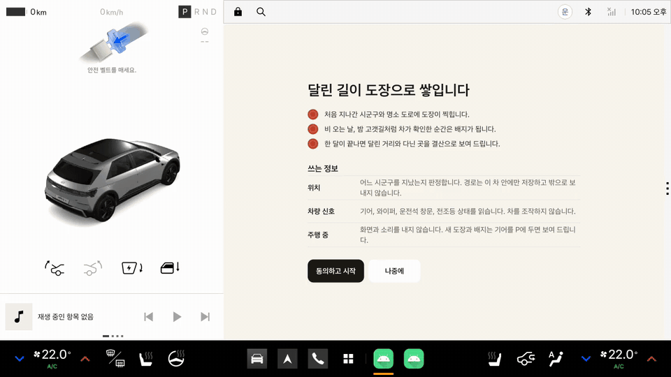
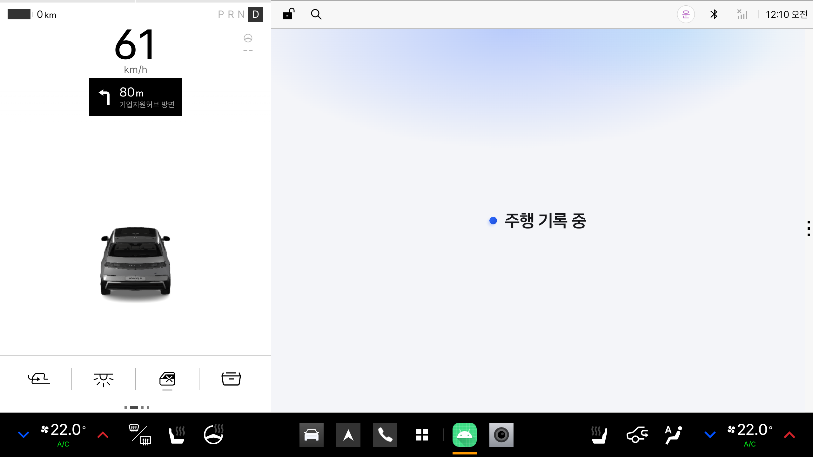
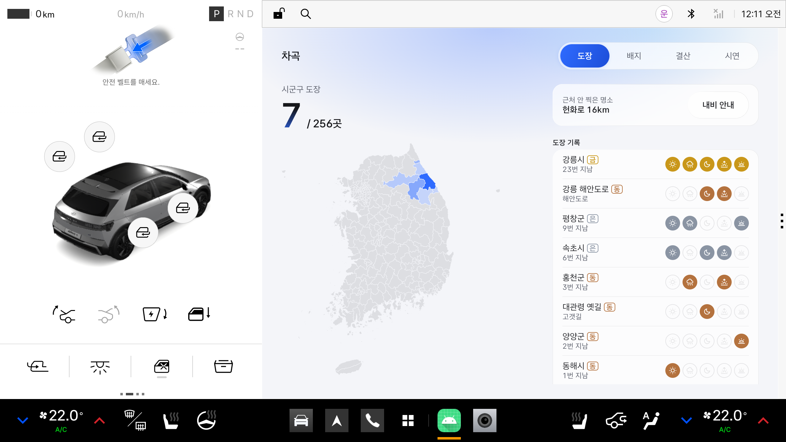
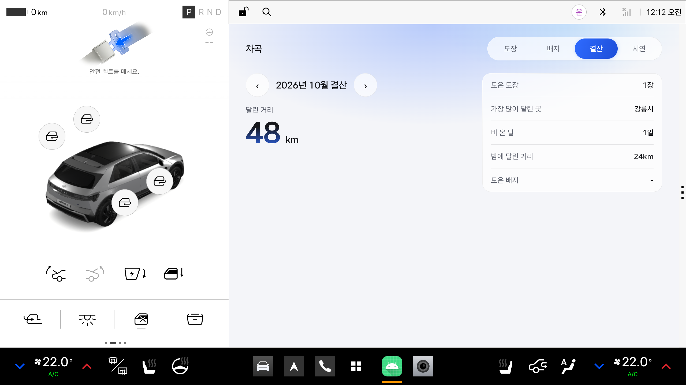
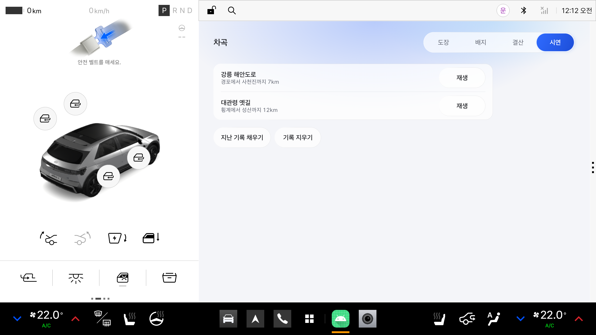
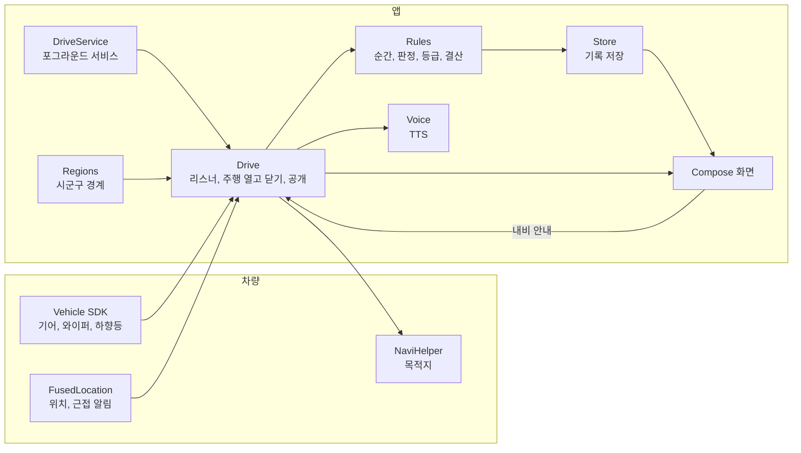

<div align="center">

# 차곡

**같은 길도 날씨, 시간, 계절마다 다른 도장이 찍히는 드라이브 도감**

현대차와 기아의 Pleos Connect 차량용 앱 | 현대차그룹 차량용 앱 개발 공모전 출품작


[APK 받기](apk/차곡_release.apk) | [시연 영상](.github/readme/demo.mp4) | [설치와 실행](#설치와-실행) | [시연 순서](#시연-순서)

<br>



<sub>Pleos Connect 에뮬레이터 v2.1.0에서 녹화했습니다. 출발 15초와 정차 뒤 44초를 이어 붙였습니다.</sub>

</div>

<br>

## 요약

차곡은 차로 지나간 시군구와 명소에 도장을 찍는 Pleos Connect 앱입니다. 도장은 장소만이 아니라 그때의 순간까지 담습니다. 같은 강릉이라도 비 오는 날, 밤, 새벽, 노을, 맑은 낮에 지나가면 각각 다른 도장이 되고, 봄, 여름, 가을, 겨울도 따로 셉니다. 비는 와이퍼, 밤은 전조등과 해 진 시각으로 차가 직접 확인합니다.

한 번 찍으면 끝나는 스탬프와 달리, 출퇴근길처럼 매일 다니는 길도 날씨와 계절이 바뀔 때마다 새 칸이 채워집니다. 같은 곳을 자주 지나면 동, 은, 금 등급이 오르고 지도가 진해집니다. 정차 중에는 근처에서 아직 못 받은 명소를 알려 주고 Pleos 내비로 바로 안내합니다.

운전 중에는 "주행 기록 중" 한 줄만 보이고, 새 도장은 기어를 P에 둔 뒤에 한 번 보여 줍니다.

| 항목 | 내용 |
|---|---|
| 한 줄 소개 | 같은 길도 날씨, 시간, 계절마다 다른 도장이 찍히는 드라이브 도감 |
| 주 사용자 | 드라이브와 여행을 즐기는 20~40대 운전자 |
| 함께 쓰는 사람 | 매일 같은 길을 달리는 출퇴근 운전자 |
| 화면 | 8개 (동의, 주행 중, 정차 후 공개, 도장, 도장첩, 배지, 결산, 시연) |
| 도장 | 시군구 256곳과 명소 11곳, 곳마다 순간 5가지 x 계절 4가지 = 20칸 |
| 등급과 배지 | 지난 횟수로 동(1번), 은(5번), 금(20번). 큰 목표 배지 12개 |
| 사용 SDK | Pleos Vehicle, FusedLocation, NaviHelper, TextToSpeech |
| 저장 | 기기 안 파일 두 개. 서버 없이 동작합니다 |
| 검증 | 단위 테스트 20건 통과, 에뮬레이터에서 경로 재생과 내비 안내 확인 |

<br>

## 문제 정의

국내 여행의 84.5%가 자가용으로 갑니다. 그런데 차로 다닌 기록은 어디에도 남지 않습니다. 내비 앱은 이동 통계만 보여 주고, 차량 월간 리포트는 이메일로 오는 주행 정보에 그칩니다.

지역은 방문객을 부르려고 스탬프 투어와 지역화폐 보상에 예산을 씁니다. 하지만 폰 GPS 스탬프는 실제로 차를 타고 왔는지 증명하지 못하고, 한 번 찍으면 끝나서 다시 올 이유를 만들지 못합니다.

| 항목 | 값 | 출처 |
|---|---|---|
| 국내여행 교통수단 중 자가용 | 84.5% | 2025 국민여행조사, 세계일보 2026-06-30 |
| 국내여행 횟수 | 약 3억 900만 회, 1인당 6.5회 | 위와 같음 |
| 디지털 관광주민증(경북) | 발급 122만 1,064건, 이용 3만 5,878건 | 뉴시스 2026-07-11 |
| 지자체 스탬프 보상 | 구미 8곳 인증 시 지역화폐 최대 2만 원, 남양주 최대 4만 원 | 텔트립, 헤럴드K |

<br>

## 차별점

스탬프 모으기와 방문 지도는 이미 흔합니다. 차곡은 폰 앱으로는 만들 수 없는 것에 집중합니다.

| 이미 흔한 것 | 차곡이 다른 점 |
|---|---|
| 폰 GPS 자동 스탬프 | 기어가 P가 아닐 때만 인정합니다. 걸어서 지나가면 찍히지 않습니다 |
| 한 번 찍으면 끝나는 스탬프 | 같은 곳도 비, 밤, 새벽, 노을, 낮과 계절마다 새 도장이고, 자주 갈수록 등급이 오릅니다 |
| 사진이나 날씨 앱으로 고르는 순간 | 와이퍼와 전조등 같은 차 신호, 해 뜨고 지는 시각으로 그 순간을 확인합니다 |
| 가 볼 곳 추천 목록 | 정차 중 가장 가까운 안 찍은 명소를 Pleos 내비 목적지로 바로 보냅니다 |

<br>

## 주요 기능

### 주행 중에는 한 줄만



기어가 P에서 벗어나면 화면은 전환 효과 없이 "주행 기록 중" 한 줄로 바뀌고 모든 모션이 멈춥니다. 소리도 내지 않습니다. 도장 판정은 화면과 상관없이 포그라운드 서비스에서 계속 돌아갑니다. 다른 앱을 앞에 띄워도 위치와 차량 신호가 끊기지 않습니다.

### 정차 후 공개


기어를 P에 두고 3초가 지나면 이번 주행을 한 화면으로 보여 줍니다. 맨 위에 "11월 9일, 밤"처럼 날짜와 그날의 순간을 적고, 새 도장("밤의 강릉시", "비 오는 평창군"), 오른 등급, 받은 배지를 목록으로 보여 줍니다. "새 도장 2장을 모았습니다"처럼 짧게 읽어 줍니다. 새로 받은 것이 없으면 아무것도 띄우지 않습니다.

### 도장 지도와 기록



전국 256개 시군구 지도에서 지나간 곳을 칠합니다. 많이 지난 곳일수록 진하게 칠해서 내 생활권이 드러납니다. 오른쪽 도장 기록은 곳마다 등급(동, 은, 금)과 지난 횟수, 순간 5칸(낮, 비, 밤, 새벽, 노을)을 보여 줍니다. 받은 칸은 그곳 등급 색으로 찍혀서, 어느 곳의 어느 순간이 비었는지 한눈에 보입니다.

맨 위에는 지금 위치에서 가장 가까운 안 찍은 명소를 보여 줍니다. "내비 안내"를 누르면 그 명소의 시작점이 Pleos 내비 목적지로 들어갑니다.

### 도장첩


도장 기록에서 한 곳을 누르면 그곳의 도장첩이 열립니다. 계절 4줄과 순간 5칸으로 된 20칸 판이고, 찍힌 칸은 등급 색으로 채워집니다.

### 배지


배지는 오래 쌓아야 받는 큰 목표 12개입니다. 받은 배지는 파란 메달에 받은 날짜를, 받기 전 배지는 흐린 메달에 진행도(예: 7 / 18곳, 17 / 20칸)를 보여 줍니다. 모든 카드는 같은 높이로 맞춥니다.

### 월간 결산



달마다 달린 거리, 모은 도장 수, 가장 많이 달린 시군구, 비 온 날(와이퍼를 켠 날), 밤에 달린 거리, 모은 배지를 보여 줍니다. 화살표로 지난달 결산도 볼 수 있습니다.

### 동의와 시연

| 동의 | 시연 |
|---|---|
|  |  |
| 쓰는 권한과 쓰는 곳을 한 줄씩 보여 줍니다. "동의하고 시작"을 눌러야만 기록을 시작합니다. | 정해 둔 경로를 재생합니다. "지난 기록 채우기"는 강원 시군구 7곳과 명소 2곳을 1년에 걸쳐 지난 기록 48번을 넣어 등급과 도장첩을 바로 보여 줍니다. 기록은 두 번 눌러 지웁니다. |

<br>

## 도장 규칙

모든 판정은 기어가 P가 아닌 동안의 주행에서만 합니다. 장소, 순간, 계절이 같으면 같은 도장이라 다시 찍히지 않습니다.

| 도장 | 조건 | 쓰는 신호 |
|---|---|---|
| 시군구 도장 | 한 번의 주행에서 같은 시군구 안을 500m 이상 달림. 그 주행에서 가장 오래 달린 순간으로 찍습니다 | FusedLocation 위치, 기어 |
| 명소 도장 | 구간 시작점과 끝점(반경 300m)을 순서대로 지남. 끝점에 닿은 순간으로 찍습니다 | FusedLocation 근접 알림 |

| 순간 | 판정 (위에서부터 먼저 봅니다) |
|---|---|
| 비 | 앞 와이퍼가 켜져 있음 |
| 노을 | 해 지는 시각 앞뒤 15분 |
| 새벽 | 해 뜨기 1시간 전부터 해 뜬 뒤 30분까지 |
| 밤 | 전조등(하향등)이 켜져 있거나 해 진 뒤 |
| 낮 | 위에 해당하지 않을 때 |

계절은 날짜로 정합니다(봄 3~5월, 여름 6~8월, 가을 9~11월, 겨울 12~2월). 해 뜨고 지는 시각은 위도, 경도와 날짜로 기기 안에서 계산합니다. 1초 사이에 1km 넘게 움직인 위치는 잘못 들어온 값으로 보고 거리에 넣지 않습니다.

| 등급 | 같은 곳을 지난 주행 수 | 색 |
|---|---|---|
| 동 | 1번 | `#B4723E` |
| 은 | 5번 | `#8A94A3` |
| 금 | 20번 | `#C9971A` |

| 명소 | 종류 | 찍을 수 있는 때 |
|---|---|---|
| 강릉 해안도로, 헌화로, 달맞이길, 애월 해안도로, 물미해안도로 | 해안도로 | 언제나 |
| 대관령 옛길, 미시령 옛길, 한계령 | 고갯길 | 언제나 |
| 여의도 윤중로 | 벚꽃길 | 4월 |
| 내장산 단풍길 | 단풍길 | 10월 15일부터 11월 15일까지 |
| 호미곶 | 해돋이 | 1월 1일 |

## 배지 규칙

| 코드 | 이름 | 조건 |
|---|---|---|
| B-01 | 열 곳의 방문자 | 서로 다른 시군구 10곳 |
| B-02 | 전국 여행자 | 서로 다른 시군구 50곳 |
| B-03 | 강원 완주 | 강원 시군구 18곳 모두 |
| B-04 | 1,000km 달성 | 누적 주행 1,000km |
| B-05 | 빗길 드라이버 | 와이퍼를 켜고 누적 100km |
| B-06 | 해안길 탐험가 | 해안 명소 3곳 지나기 |
| B-07 | 고갯길 탐험가 | 고개 명소 3곳 지나기 |
| B-08 | 한정 도장 | 기간 한정 명소 1곳 |
| B-09 | 하루의 모든 얼굴 | 한 곳에서 순간 5가지 |
| B-10 | 사계절 | 한 곳에서 계절 4가지 |
| B-11 | 도장첩 완성 | 한 곳의 20칸 모두 |
| B-12 | 단골 | 한 곳을 20번 지나 금 등급 |

<br>

## 안전 설계

공모전이 안내한 Pleos 개발자 가이드의 주행 중 동작 기준을 먼저 정하고 화면을 그렸습니다. 왼쪽은 가이드 기준, 오른쪽은 차곡의 구현입니다.

| 가이드 기준 | 구현 |
|---|---|
| 주행 중 1~2초 안에 파악, 애니메이션 금지 | 기어가 P에서 벗어나면 전환 효과 없이 한 줄 화면으로 바꾸고 앱 전체의 모션을 끕니다 |
| 운전에 필요한 알림만 | 주행 중에는 소리와 화면 변화가 없습니다. 공개는 기어 P 3초 뒤 한 번입니다 |
| 오디오 포커스 | 읽어 주기는 `GAIN_TRANSIENT_MAY_DUCK`으로 포커스를 받아 내비 안내와 겹치지 않게 합니다 |
| 운전자에게 행동을 유도하지 않음 | 빈 칸을 채우라고 주행 중에 알리지 않습니다. 근처 명소와 내비 안내는 정차 중 도장 탭에서만 보이고, 누를 때만 목적지를 보냅니다 |
| 대비 4.5:1 이상 | 본문 16.4:1, 보조 글자 5.9:1 (밝은 테마), 파란 바탕 위 흰 글자 4.5:1 이상 |
| 한 손 조작 | 누르는 영역은 모두 88dp 이상입니다 |
| CCP 미지원 선언, Back은 `moveTaskToBack` | 매니페스트에 `ROTARY_SUPPORTED=false`를 선언했고, 뒤로 가기는 앱을 닫지 않고 뒤로 보냅니다. 알림을 눌러도 화면이 겹쳐 쌓이지 않게 `singleTask`로 엽니다 |
| 위치 사용은 명시적 동의 | "동의하고 시작" 버튼으로만 동의하고, 그 뒤에 FusedLocation 권한을 요청합니다 |

<br>

## 개인정보

| 원칙 | 구현 |
|---|---|
| 기기 안에만 저장 | 위치, 차량 신호는 앱 내부 파일에만 저장하고 서버로 보내지 않습니다 |
| 필요한 만큼만 저장 | 좌표는 판정 뒤 버리고, 주행마다 시군구별, 순간별 거리와 지난 명소만 남깁니다 |
| 지울 권리 | 시연 탭에서 기록을 모두 지울 수 있습니다 |
| 읽기 권한만 | 차량 권한은 기어, 와이퍼, 전조등을 읽는 권한뿐이고 차를 조작하지 않습니다. 와이퍼를 읽는 데 창문 권한(`CAR_WINDOWS`)이 필요해 함께 받습니다 |
| 내비는 누를 때만 | 내비 권한은 "내비 안내"를 눌렀을 때 목적지 한 곳을 보낼 때만 씁니다 |

<br>

## 디자인

밝은 바탕에 파란 빛 하나를 강조색으로 씁니다(`ui/Theme.kt`). 기기가 어두운 테마면 어두운 색으로 바뀝니다. 탭, 버튼, 목록은 반투명 유리 판 위에 올리고, 화면 위쪽에는 파란 불빛이 은은하게 번집니다.

도장은 등급 색(동, 은, 금)으로 찍고, 지도는 지난 횟수만큼 연한 파랑에서 진한 파랑으로 칠합니다. 파랑은 지도, 고른 탭, 주 버튼, 받은 배지에만 씁니다. 받기 전 칸과 배지는 선으로만 그립니다.

| 토큰 | 밝은 테마 | 어두운 테마 |
|---|---|---|
| 배경 | `#F4F5F9` | `#121317` |
| 유리 판 | 흰색 70% | 흰색 8% |
| 본문 | `#16171B` | `#EEF0F3` |
| 보조 글자 | `#5B5F6B` | `#A3A8B4` |
| 강조 | `#2F6BFF`, `#1D4ED8` | 같음 |

글자 크기는 1~2초 안에 읽히도록 차량용(본문 28sp)으로 키웠습니다. 한국어는 낱말 단위로 줄을 바꿉니다.

| 모션 | 쓰는 곳 |
|---|---|
| 스프링 눌림 | 버튼과 탭을 누르면 95%로 살짝 눌렸다가 튕기며 돌아옵니다. 짧은 진동도 함께 줍니다 |
| 손끝 불빛 | 누른 자리에서 빛이 번졌다가 손을 떼면 0.3초 동안 사라집니다 |
| 미끄러지는 선택 알약 | 탭을 바꾸면 파란 알약이 스프링으로 옮겨 갑니다 |
| 자릿수별로 굴러가는 숫자 | 도장 받은 시군구 수, 달린 거리 |
| 즉시 정지 | 주행 중이 되면 진행 중인 모션도 바로 끝 상태로 바뀌고, 눌림 크기 변화도 멈춥니다 |

<br>

## 설치와 실행

### 준비물

| 항목 | 값 |
|---|---|
| 에뮬레이터 | Pleos Connect v2.1.0 (Android 14, API 34, 2560×1440) |
| 차량 값 조작 | Pleos Connect Virtual Console (`http://127.0.0.1:8088/`) |
| APK | [`apk/차곡_release.apk`](apk/차곡_release.apk) (release 빌드) |
| JDK | Android Studio에 들어 있는 JBR (직접 빌드할 때) |

### APK로 설치

```bash
adb install -r apk/차곡_release.apk
```

### 직접 빌드

```bash
export JAVA_HOME="/Applications/Android Studio.app/Contents/jbr/Contents/Home"
```

```bash
./gradlew :app:assembleDebug
```

```bash
adb install -r app/build/outputs/apk/debug/app-debug.apk
```

앱 서랍에서 차곡을 열고 "동의하고 시작"을 누른 뒤 알림과 위치 권한을 허용합니다. 앱은 사용자 10으로 실행되므로, 권한을 미리 주려면 `adb shell pm grant --user 10 com.example.chagok pleos.car.permission.FUSED_LOCATION`을 씁니다. 차량 전용 앱(`android.hardware.type.automotive`)이라 휴대폰 에뮬레이터에는 설치되지 않습니다.

Pleos SDK는 `https://nexus-playground.pleos.ai/repository/maven-releases/`에서 받습니다.

### 테스트

```bash
./gradlew :app:testDebugUnitTest
```

<br>

## 시연 순서

위 영상과 같은 화면을 보는 순서입니다. 경로 재생과 지난 기록 채우기는 debug와 release 빌드 모두 시연 탭에 있습니다. 순간은 지금 시각으로 판정하므로, 밤에 하면 "밤의" 도장이 찍힙니다. 낮에도 밤 도장을 보려면 Virtual Console에서 전조등을 켭니다.

| 순서 | 앱 | Virtual Console |
|---|---|---|
| 1 | 시연 탭에서 "강릉 해안도로" 재생 | Gear: P, 충전구 닫힘 |
| 2 | "주행 기록 중" 화면으로 바뀜 | 재생 1초 뒤 Gear: D, 속도는 30~65km/h 사이로 바꿈 |
| 3 | | 재생 45초 뒤 속도 0, Gear: P |
| 4 | 3초 뒤 "새 도장 2장"(강릉시, 강릉 해안도로)과 음성 | |
| 5 | 확인을 누르고 시연 탭에서 "지난 기록 채우기" | |
| 6 | 도장 탭에서 금, 은, 동 도장과 근처 명소, "내비 안내" | |
| 7 | 강릉시를 눌러 도장첩, 배지 탭, 결산 탭 | |
| 8 | 와이퍼를 켜고 "대관령 옛길" 재생 | 와이퍼 켬, Gear: D, 65초 뒤 Gear: P. "비 오는" 도장 |

<details>
<summary>실제 위치로 시험하기</summary>

경로 재생 대신 에뮬레이터 위치를 직접 옮기면 FusedLocation 위치와 근접 알림을 그대로 씁니다. 1초에 100~150m씩 옮겨야 거리에 들어갑니다.

```bash
adb emu geo fix 129.0350 37.6880
```

헌화로 시작점(37.6880, 129.0350)에서 끝점(37.6650, 129.0530)까지 옮긴 뒤 기어를 P에 두면 헌화로 도장을 받습니다. 기어 P인 채로 옮기면 아무것도 기록되지 않습니다.

</details>

<br>

## 구조



| 파일 | 하는 일 |
|---|---|
| `DriveService.kt` | `specialUse` 포그라운드 서비스("drive recording")로 `Drive`를 시작하고 끝냅니다 |
| `Drive.kt` | 차량 리스너와 위치, 근접 알림을 받아 주행 한 번을 열고 닫습니다. 기어 P 3초 뒤 공개, 경로 재생, 내비 안내를 다룹니다 |
| `Rules.kt` | 순간 판정, `Recorder`(주행 중 시군구별, 순간별 거리), `judge`(새 도장, 등급, 배지), `recap`(월간 결산). 명소, 시연 경로, 지난 기록도 여기 있습니다 |
| `Regions.kt` | 시군구 경계를 읽고 좌표가 어느 시군구 안인지 찾습니다. 경계 상자로 먼저 거르고 직전 시군구부터 봅니다 |
| `Store.kt` | 기록을 `AtomicFile`로 저장합니다. 진행 중인 주행은 따로 저장해서, 앱이 꺼져도 다음 실행 때 정산합니다 |
| `Voice.kt` | 기기 안(ON_DEVICE) TTS와 오디오 포커스를 다룹니다 |
| `Sun.kt` | 위도, 경도로 해 뜨고 지는 시각을 계산합니다 |
| `ui/` | 화면 8개와 디자인 토큰, 공통 컴포넌트 |

<br>

## 기술 스택

| 영역 | 사용 |
|---|---|
| 언어, UI | Kotlin 2.2, Jetpack Compose (BOM 2026.09.00) |
| 차량 | Pleos Vehicle 2.3.2 |
| 위치 | Pleos FusedLocation 1.1.3 (위치, 근접 알림) |
| 내비 | Pleos NaviHelper 3.0.5 (`requestRoute`) |
| 음성 | Pleos TextToSpeech 3.3.1 (ON_DEVICE, 네트워크 불필요) |
| 저장 | `AtomicFile` JSON, `SharedPreferences` |
| 백그라운드 | 포그라운드 서비스 `specialUse` |
| 빌드 | AGP 9.4, minSdk 34, targetSdk 37 |

<br>

## 검증 결과

| 항목 | 결과 |
|---|---|
| 단위 테스트 | 20건 통과. 시군구 판정 5건(256곳 읽기, 경계 양쪽, 바다, 시연 경로), 순간, 도장, 등급, 기간 한정, 배지, 근처 명소, 지난 기록, 결산 15건 |
| 강릉 해안도로 재생 (밤) | D로 달린 뒤 P. 3초 뒤 "새 도장 2장", 밤의 강릉시, 밤의 강릉 해안도로 |
| 대관령 옛길 재생 (밤) | 밤의 강릉시, 밤의 대관령 옛길. 이미 있는 평창군 가을 밤 도장은 다시 찍히지 않음 |
| 지난 기록 채우기 | 강원 7곳과 명소 2곳. 강릉시 금, 평창군과 속초시 은, 나머지 동. 지도 농도가 횟수만큼 다름 |
| 근처 명소와 내비 안내 | 강릉 근처에서 "헌화로 16km". 누르면 Pleos 내비에 강릉 해안도로 경로가 뜸 |
| 걸어서 지나가기 | 기어 P인 채 미시령 구간을 옮김. 아무것도 기록되지 않음 |
| 백그라운드 | 앱이 뒤에 있을 때 `DriveService`가 `isForeground=true`, 종류 specialUse로 동작 |

<sub>2026-11-05부터 2026-11-09까지 Pleos Connect 에뮬레이터 v2.1.0, 사용자 10에서 확인했습니다. 차량 값은 Virtual Console로 바꿨습니다.</sub>

<details>
<summary>미검증 항목</summary>

| 항목 | 이유 |
|---|---|
| 기간 한정 명소 3곳 실주행 | 날짜가 맞지 않아 단위 테스트로만 확인했습니다 |
| 새벽, 노을 순간 실기 획득 | 시각이 맞지 않아 단위 테스트로만 확인했습니다 |
| App Market의 `specialUse` 포그라운드 서비스 허용 | 심사 기준에서 확인하지 못했습니다. `location` 종류는 Android 위치 권한을 요구하는데 이 앱은 Pleos FusedLocation 권한만 씁니다 |
| 앱이 뒤에 있을 때 공개 화면 | 지금은 음성만 나오고, 앱을 열면 공개 화면이 보입니다 |
| 서비스가 다시 시작된 뒤 리스너와 근접 알림 | 프로세스를 끊어 보는 시험을 하지 않았습니다 |
| 실차의 와이퍼, 전조등 값 | 에뮬레이터 값만 확인했습니다 |
| 시연 경로 밖 명소 좌표 | 시연용 근사값입니다 |
| 어두운 테마, 세로 창, TalkBack | 이번 화면 개편 뒤에는 확인하지 않았습니다 |

</details>

<details>
<summary>기획 대비 변경</summary>

| 기획 | 구현 | 이유 |
|---|---|---|
| 상황 배지(빗속 드라이브, 밤길, 노을 드라이브 등) | 순간 도장 | 한 번 받으면 끝나서, 같은 곳을 다시 갈 이유가 되도록 장소와 순간을 묶었습니다 |
| 창문 열고 해안도로 배지 | 뺌 | 순간 5가지에 맞지 않습니다 |
| 공유 이미지(QR) | 뺌 | 공유 페이지를 올릴 곳이 정해지지 않아 이번 제출에서는 제외했습니다 |
| 주행 거리는 Vehicle 주행거리계 | 위치 두 점 사이 거리 | 시연 경로 재생과 `geo fix`에서는 주행거리계가 움직이지 않습니다 |
| 앱이 화면에 없을 때 기록은 Sprint 0에서 확인 | 포그라운드 서비스 필수 | 일반 앱은 다른 화면을 띄우자마자 프로세스가 얼어 위치와 차량 신호가 모두 멈췄습니다 |
| 근접 알림은 주변 명소만 등록 | 명소 11곳의 시작점과 끝점 22개를 모두 등록 | 60개 등록까지 오류가 없었습니다 |
| 명소 구간 판정은 근접 알림만 | 시연 경로 재생 중에는 같은 반경으로 앱이 직접 판정 | 경로 재생은 FusedLocation을 거치지 않습니다 |
| minSdk 28 | minSdk 34 | `specialUse` 서비스 종류가 API 34부터 있습니다 |

</details>

<br>

## 데이터 출처와 라이선스

| 데이터 | 출처 | 라이선스 |
|---|---|---|
| 시군구 경계 | 통계청 SGIS 행정구역 경계를 가공한 [vuski/admdongkor](https://github.com/vuski/admdongkor) 2026-10-01판. 행정동을 시군구 256곳으로 합치고 약 100m 단위로 단순화했습니다(937KB) | CC BY 4.0, 공공누리 제1유형 |
| 명소 좌표 | 시연용 근사값 | - |
| 아이콘 | Google [Material Symbols](https://github.com/google/material-design-icons), [Tabler Icons](https://github.com/tabler/tabler-icons) | Apache 2.0, MIT |

<br>

## 남은 작업

- [ ] 공유: 도장첩과 주행 공개를 폰으로 넘기는 QR (공유 페이지를 올릴 곳 정하기)
- [ ] App Market의 `specialUse` 포그라운드 서비스 허용 여부 확인
- [ ] 지자체, 관광공사와 지역 명소, 기간 한정 도장 혜택 협의
