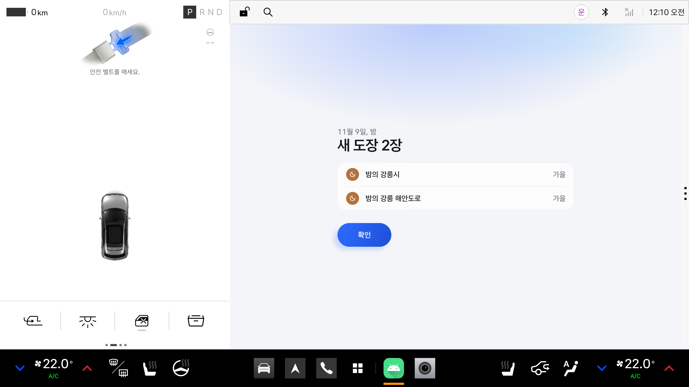
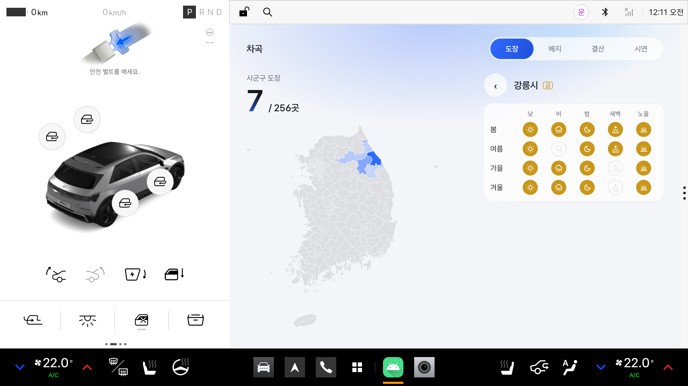
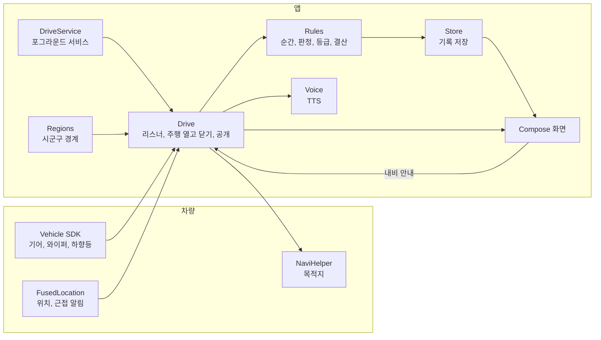

<div align="center">

# 차곡

**같은 길도 날씨, 시간, 계절마다 다른 도장이 찍히는 드라이브 도감**

Pleos Connect 차량용 앱 | 현대차그룹 차량용 앱 개발 공모전 출품작


[APK 받기](apk/차곡_release.apk) | [시연 영상](.github/readme/demo.mp4) | [설치와 실행](#설치와-실행) | [시연 순서](#시연-순서)

<br>


</div>

## 요약

차곡은 차로 지난 시군구와 명소에 그때의 순간(낮, 비, 밤, 새벽, 노을)과 계절을 담은 도장을 찍는 Pleos Connect 앱입니다. 같은 곳도 순간과 계절이 바뀌면 새 칸이 열려서, 한 번 찍으면 끝나는 스탬프와 달리 다시 달릴 이유가 생깁니다.

| 항목 | 내용 |
|---|---|
| 사용자 | 주말 드라이브를 하는 운전자, 출퇴근 운전자 |
| 도장 | 시군구 256곳, 명소 11곳. 곳마다 순간 5가지 x 계절 4가지 = 20칸 |
| 판정 신호 | 기어, 와이퍼(비), 전조등과 해 뜨고 지는 시각(밤, 새벽, 노을), 위치 |
| 등급 | 같은 곳을 지난 날수로 동(1일), 은(5일), 금(20일) |
| 사용 SDK | Pleos Vehicle, FusedLocation, NaviHelper, TextToSpeech |

## 문제 정의

차곡은 운전자 쪽 문제 하나와 지역 쪽 문제 하나를 함께 풉니다.

### 운전자: 차로 다녀온 여행이 아무것도 남지 않습니다

국내 여행의 84.5%는 자가용으로 갑니다. 그런데 운전자는 운전하는 동안 사진도 메모도 남길 수 없습니다. 비 오는 대관령 옛길을 넘어도 남는 것은 동승자 휴대폰에 흩어진 사진 몇 장이고, 휴대폰 타임라인은 위치만 남겨서 그날 비가 왔는지 밤이었는지는 기록되지 않습니다. 다녀온 뒤에는 그 길을 몇 번, 어떤 날씨에 달렸는지 기억으로만 남습니다.

### 지역: 방문객이 다시 와야 하는데, 다시 올 이유가 없습니다

인구가 줄어드는 지역은 방문객으로 버팁니다. 2026년 5월 인구감소지역에는 주민의 5.8배나 되는 사람이 드나들었습니다. 그래서 지자체는 스탬프 투어와 디지털 관광주민증에 예산을 씁니다. 하지만 스탬프는 한 지점에 들어가면 찍히고 한 번으로 끝나고, 관광주민증은 발급만 하고 쓰지 않는 경우가 대부분입니다. 경북은 관광주민증을 122만 건 발급했지만 실제로 쓰인 것은 3만 6천 건입니다.

## 해결: 다시 달릴 이유를 만드는 도장

차곡은 같은 곳도 그때의 순간과 계절마다 다른 도장을 찍습니다. 운전자는 운전에 손대지 않아도 그날의 드라이브가 기록으로 남고, 지역은 같은 사람이 다른 계절, 다른 시간에 다시 올 이유를 얻습니다.

이 구조가 작동하는 이유는 네 단계입니다.

| 단계 | 근거 |
|---|---|
| 1. 여행 대부분은 차로 갑니다 | 국내 여행 교통수단의 84.5%가 자가용입니다 |
| 2. 지역에는 다시 오는 방문객이 필요합니다 | 인구감소지역 체류인구는 주민의 5.8배입니다 |
| 3. 한 번 받으면 끝나는 혜택으로는 다시 오지 않습니다 | 경북 관광주민증은 122만 건 발급, 3만 6천 건 이용에 그쳤습니다 |
| 4. 순간과 계절이 바뀌면 같은 곳도 새 칸이 열립니다 | 한 곳에 20칸이 있고, 지난 날수만큼 동, 은, 금으로 오릅니다 |

| 기존 | 차곡 |
|---|---|
| 한 지점에 들어오면 찍히는 휴대폰 GPS 스탬프 | 차에 탑재된 앱이라 차로 지난 곳만 쌓입니다. 명소는 시작점과 끝점을 순서대로 지나야 찍힙니다 |
| 한 번 찍으면 끝나는 스탬프 | 순간과 계절마다 새 도장이 찍히고, 지난 날수만큼 등급이 오릅니다 |
| 날씨 앱이 알려 주는 지역 날씨 | 와이퍼를 켜고 달린 구간만 비로 셉니다. 휴대폰은 알 수 없는 차 신호입니다 |
| 가 볼 곳 추천 목록 | 정차 중 가장 가까운 안 찍은 명소를 Pleos 내비 목적지로 보냅니다 |

| 근거 | 내용 | 출처 |
|---|---|---|
| 국내 여행 교통수단 | 자가용 84.5%, 1인당 연 6.5회 여행 (2025 국민여행조사) | [시사저널 2026-06-30](https://www.sisajournal.com/news/articleView.html?idxno=378149), 문화체육관광부 |
| 인구감소지역 체류인구 | 2026년 5월 주민 486만 명, 체류인구 2,799만 명(5.8배). 정식 통계가 아닌 실험적 통계 | [뉴스핌 2026-10-29](https://www.newspim.com/news/view/20261029000651), 국가데이터처·행정안전부 |
| 디지털 관광주민증 | 경북 발급 122만 1,064건, 이용 3만 5,878건 | [뉴시스, 네이트 뉴스 2026-07-11](https://news.nate.com/view/20260711n03267) |

## 주요 기능

| 주행 중 | 정차 후 공개 |
|---|---|
|  |  |
| 기어가 P에서 벗어나면 한 줄 화면으로 바꾸고 모션과 소리를 끕니다. 다른 앱을 띄워도 포그라운드 서비스로 기록합니다 | 기어 P 3초 뒤 날짜, 순간, 새 도장, 오른 등급을 보여 주고 "새 도장 2장을 모았습니다"처럼 읽어 줍니다 |

| 도장 지도 | 도장첩 |
|---|---|
|  |  |
| 지난 날이 많은 시군구일수록 진하게 칠합니다. 맨 위에는 가까운 안 찍은 명소와 "내비 안내" 버튼이 있습니다 | 한 곳의 20칸 판입니다. 찍힌 칸은 그곳 등급 색으로 채웁니다 |

이 밖에 오래 쌓는 목표 배지 12개와 월간 결산(달린 거리, 새 도장, 비 온 날, 밤 거리)이 있습니다. 처음 실행하면 동의 화면에서 쓰는 정보를 보여 주고, "동의하고 시작"을 눌러야 기록을 시작합니다.

## 도장 규칙

판정은 기어가 P가 아닌 동안에만 합니다. 장소, 순간, 계절이 같으면 같은 도장입니다.

| 도장 | 조건 |
|---|---|
| 시군구 | 한 주행에서 같은 시군구를 500m 이상 달리면, 가장 오래 달린 순간으로 하나 찍습니다 |
| 명소 | 구간 시작점과 끝점(반경 300m)을 순서대로 지나면, 끝점에 닿은 때의 순간으로 찍습니다 |

| 순간 | 판정 (위에서부터 먼저 맞는 하나) |
|---|---|
| 비 | 앞 와이퍼가 켜져 있습니다 |
| 노을 | 해 지는 시각 앞뒤 15분입니다 |
| 새벽 | 해 뜨기 1시간 전부터 해 뜬 뒤 30분까지입니다 |
| 밤 | 전조등(하향등)을 켰거나 해가 진 뒤입니다 |
| 낮 | 그 밖의 시간입니다 |

계절은 날짜(봄 3~5월, 여름 6~8월, 가을 9~11월, 겨울 12~2월)로 정합니다. 등급은 같은 날 여러 번 지나도 하루로 세므로, 매일 지나는 출근길도 금까지 평일 20일이 걸립니다. 명소는 해안도로 5곳, 고갯길 3곳, 기간 한정 3곳(4월 윤중로 벚꽃길, 가을 내장산 단풍길, 1월 1일 호미곶)입니다.

## 안전과 개인정보

| 기준 | 구현 |
|---|---|
| 주행 중 애니메이션 금지 | 기어가 P에서 벗어나면 전환 효과 없이 한 줄 화면으로 바꾸고 모든 모션을 끕니다 |
| 운전 중 행동 유도 금지 | 주행 중에는 소리와 알림이 없습니다. 근처 명소와 내비 안내는 정차 중에만 보입니다 |
| 오디오 포커스 | `GAIN_TRANSIENT_MAY_DUCK`으로 받아 내비 안내와 겹치지 않습니다 |
| 저장 | 좌표는 판정한 뒤 버리고, 시군구별 순간별 거리만 기기 안에 남깁니다. 서버로 보내지 않습니다 |

## 설치와 실행

| 준비물 | 값 |
|---|---|
| 에뮬레이터 | Pleos Connect v2.1.0 (Android 14, API 34, 2560×1440) |
| APK | [`apk/차곡_release.apk`](apk/차곡_release.apk) |
| 차량 값 조작 | Pleos Connect Virtual Console (`http://127.0.0.1:8088/`) |

```bash
adb install -r apk/차곡_release.apk
```

차곡을 열고 "동의하고 시작"을 누른 뒤 알림과 위치 권한을 허용합니다. 차량 전용 앱이라 휴대폰 에뮬레이터에는 설치되지 않습니다.

## 시연 순서

순간은 지금 시각으로 판정하므로, 해가 진 뒤에 하면 "밤의" 도장이 찍힙니다. 낮에는 Virtual Console에서 전조등을 켜면 "밤의" 도장이 찍힙니다.

| 순서 | 앱 | Virtual Console |
|---|---|---|
| 1 | 시연 탭에서 "강릉 해안도로" 재생 | Gear: P, 충전구 닫힘 |
| 2 | "주행 기록 중" 화면으로 바뀜 | 재생 1초 뒤 Gear: D, 속도 30~65km/h |
| 3 | | 재생 45초 뒤 속도 0, Gear: P |
| 4 | 3초 뒤 "새 도장 2장"과 음성 | |
| 5 | 시연 탭에서 "지난 기록 채우기" | |
| 6 | 도장 탭에서 금, 은, 동 도장과 근처 명소, "내비 안내" | |
| 7 | 강릉시를 눌러 도장첩, 배지 탭, 결산 탭 | |
| 8 | 와이퍼를 켜고 "대관령 옛길" 재생 | 와이퍼 켬, Gear: D, 65초 뒤 Gear: P. "비 오는" 도장 |

## 기술 스택

| 영역 | 사용 |
|---|---|
| 언어, UI | Kotlin 2.2, Jetpack Compose (BOM 2026.09.00) |
| Pleos SDK | Vehicle 2.3.2, FusedLocation 1.1.3, NaviHelper 3.0.5, TextToSpeech 3.3.1 (ON_DEVICE) |
| 백그라운드 | `specialUse` 포그라운드 서비스 |
| 저장 | `AtomicFile` JSON, `SharedPreferences` |
| 빌드 | AGP 9.4, minSdk 34, targetSdk 37 |

<details>
<summary>구조</summary>



</details>

## 앞으로

- 연간 결산과 공유 QR
- 지자체와 기간 한정 도장 혜택 협의
- 휴게소 정차 도장

## 출처

- 시군구 경계: 통계청 SGIS 행정구역 경계를 가공한 [vuski/admdongkor](https://github.com/vuski/admdongkor) 2026-10-01판(CC BY 4.0, 공공누리 제1유형). 시군구 256곳으로 합치고 약 100m 단위로 단순화했습니다.
- 아이콘: Google [Material Symbols](https://github.com/google/material-design-icons)(Apache 2.0), [Tabler Icons](https://github.com/tabler/tabler-icons)(MIT)
