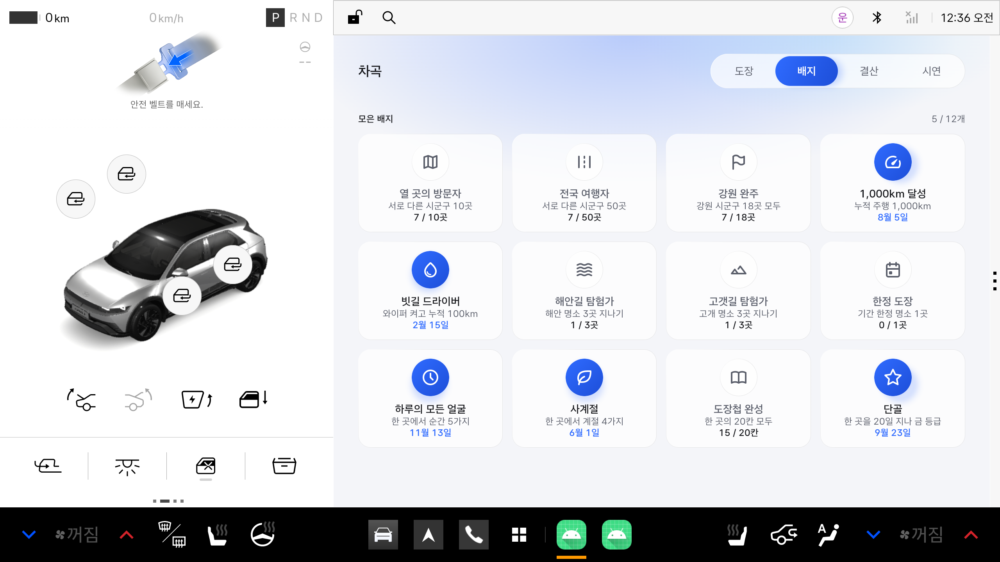
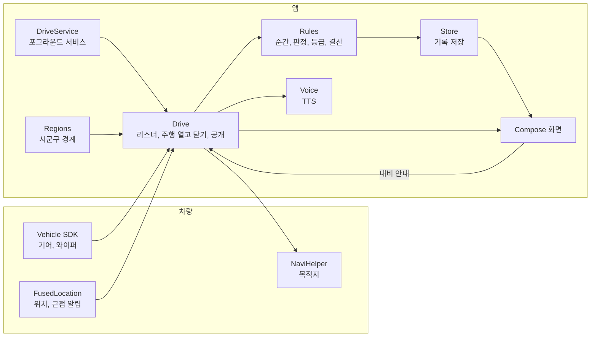

<div align="center">

# 차곡

**같은 길도 날씨, 시간, 계절마다 다른 도장이 찍히는 드라이브 도감**

Pleos Connect 차량용 앱 | 현대차그룹 차량용 앱 개발 공모전 출품작


[APK 받기](apk/차곡_release.apk) | [시연 영상](.github/readme/demo.mp4) | [설치와 실행](#설치와-실행) | [시연 순서](#시연-순서)

<br>


</div>

<br>

## 요약

차곡은 차로 지난 시군구와 명소에 그때의 순간(낮, 비, 밤, 새벽, 노을)과 계절을 담은 도장을 찍습니다. 같은 곳도 순간과 계절마다 새 칸이 열려, 한 번 찍으면 끝나는 스탬프와 달리 다시 달릴 이유가 생깁니다.

| 항목 | 내용 |
|---|---|
| 도장 | 시군구 256곳, 명소 11곳. 곳마다 순간 5가지 x 계절 4가지 = 20칸 |
| 판정 신호 | 비는 와이퍼, 밤, 새벽, 노을은 해 뜨고 지는 시각 |
| 등급 | 같은 곳을 지난 날수로 동(1일), 은(5일), 금(20일) |
| 운전 중 화면 | "주행 기록 중" 한 줄. 새 도장은 기어 P 3초 뒤 공개 |
| 사용자 | 주말 드라이브를 하는 20~40대 운전자, 출퇴근 운전자 |
| 검증 | 단위 테스트 20건 통과, 에뮬레이터 경로 재생과 내비 안내 확인 |

<br>

## 문제 정의

운전자는 드라이브의 순간을 남길 수 없습니다. 운전 중에는 사진도 메모도 할 수 없고, 다녀온 뒤에는 어디를 몇 번, 어떤 날씨에 달렸는지 기억으로만 남습니다.

| 대상 | 불편한 순간 | 지금 쓰는 방법과 한계 |
|---|---|---|
| 드라이브하는 운전자 | 비 오는 대관령 옛길을 넘어도 운전 중이라 사진 한 장 남기지 못합니다. 다녀온 뒤에는 그 길을 몇 번 갔는지도 모릅니다 | 동승자가 찍은 사진은 사진첩에 흩어집니다. 폰 타임라인은 위치만 남겨, 그날 비가 왔는지 밤이었는지는 없습니다 |
| 지자체, 관광공사 | 스탬프 투어에 보상 예산을 써도 방문객이 한 번 찍고 다시 오지 않습니다 | 폰 GPS 스탬프는 한 지점에 들어오면 찍히고 한 번으로 끝납니다. 경북 디지털 관광주민증은 발급 대비 이용이 2.9%입니다 |

국내 여행 약 3억 900만 회 가운데 84.5%가 자가용이라, 이 불편은 국내 여행 대부분에서 생깁니다.

| 항목 | 값 | 출처 |
|---|---|---|
| 국내여행 교통수단 중 자가용 | 84.5% | 2025 국민여행조사, 세계일보 2026-06-30 |
| 국내여행 횟수 | 약 3억 900만 회, 1인당 6.5회 | 위와 같음 |
| 디지털 관광주민증(경북) | 발급 122만 1,064건, 이용 3만 5,878건(2.9%) | 뉴시스 2026-07-11 |
| 지자체 스탬프 보상 | 구미 8곳 인증 시 지역화폐 최대 2만 원, 남양주 최대 4만 원 | 텔트립, 헤럴드K |

## 차별점

| 기존 | 차곡 |
|---|---|
| 한 지점에 들어오면 찍히는 폰 GPS 스탬프 | 차에 탑재된 앱이라 차로 지난 곳만 쌓입니다. 명소는 시작점과 끝점을 순서대로 지나야 찍힙니다 |
| 한 번 찍으면 끝나는 스탬프 | 순간과 계절마다 새 도장이 찍히고, 지난 날수만큼 등급이 오릅니다 |
| 날씨 앱이 알려 주는 지역 날씨 | 와이퍼를 켜고 달린 구간만 비로 셉니다 |
| 가 볼 곳 추천 목록 | 정차 중 가장 가까운 안 찍은 명소를 Pleos 내비 목적지로 보냅니다 |

<br>

## 주요 기능

| 주행 중 | 정차 후 공개 |
|---|---|
|  |  |
| 기어가 P에서 벗어나면 한 줄 화면으로 바꾸고 모션과 소리를 끕니다. 다른 앱을 띄워도 포그라운드 서비스로 기록합니다 | 기어 P 3초 뒤 날짜, 순간, 새 도장, 오른 등급, 배지를 보여 주고 "새 도장 2장을 모았습니다"처럼 읽어 줍니다 |

| 도장 지도 | 도장첩 |
|---|---|
|  |  |
| 지난 날이 많은 시군구일수록 진하게 칠합니다. 맨 위에는 가까운 안 찍은 명소와 "내비 안내" 버튼이 있습니다 | 한 곳의 20칸 판입니다. 찍힌 칸은 등급 색으로 채웁니다 |

| 배지 | 월간 결산 |
|---|---|
|  |  |
| 오래 쌓는 목표 12개. 받기 전에는 진행도(예: 7 / 18곳)를 보여 줍니다 | 달린 거리, 새 도장, 가장 많이 달린 곳, 비 온 날, 밤 거리, 배지 |

동의 화면은 위치와 차량 신호 두 권한과 쓰는 곳을 보여 주고, "동의하고 시작"을 눌러야 기록을 시작합니다.

<br>

## 도장 규칙

판정은 기어가 P가 아닌 동안에만 합니다. 장소, 순간, 계절이 같으면 같은 도장입니다.

| 도장 | 조건 |
|---|---|
| 시군구 | 한 주행에서 같은 시군구를 500m 이상 달리면, 가장 오래 달린 순간으로 하나 찍습니다 |
| 명소 | 구간 시작점과 끝점(반경 300m)을 순서대로 지나면, 끝점에 닿은 때의 순간으로 찍습니다 |

| 순간 | 판정 (위에서부터 먼저 맞는 하나) |
|---|---|
| 비 | 앞 와이퍼가 켜져 있습니다 |
| 노을 | 해 지는 시각 앞뒤 15분입니다 |
| 새벽 | 해 뜨기 1시간 전부터 해 뜬 뒤 30분까지입니다 |
| 밤 | 해가 진 뒤입니다 |
| 낮 | 그 밖의 시간입니다 |

계절은 날짜(봄 3~5월, 여름 6~8월, 가을 9~11월, 겨울 12~2월)로 정합니다. 등급은 같은 날 여러 번 지나도 하루로 세므로, 매일 지나는 출근길도 금까지 평일 20일이 걸립니다.

<details>
<summary>등급 색, 명소, 배지 목록</summary>

| 등급 | 날수 | 색 |
|---|---|---|
| 동 | 1일 | `#B4723E` |
| 은 | 5일 | `#8A94A3` |
| 금 | 20일 | `#C9971A` |

| 명소 | 종류 | 찍을 수 있는 때 |
|---|---|---|
| 강릉 해안도로, 헌화로, 달맞이길, 애월 해안도로, 물미해안도로 | 해안도로 | 언제나 |
| 대관령 옛길, 미시령 옛길, 한계령 | 고갯길 | 언제나 |
| 여의도 윤중로 | 벚꽃길 | 4월 |
| 내장산 단풍길 | 단풍길 | 10월 15일부터 11월 15일까지 |
| 호미곶 | 해돋이 | 1월 1일 |

| 코드 | 이름 | 조건 |
|---|---|---|
| B-01 | 열 곳의 방문자 | 서로 다른 시군구 10곳 |
| B-02 | 전국 여행자 | 서로 다른 시군구 50곳 |
| B-03 | 강원 완주 | 강원 시군구 18곳 모두 |
| B-04 | 1,000km 달성 | 누적 주행 1,000km |
| B-05 | 빗길 드라이버 | 와이퍼를 켜고 누적 100km |
| B-06 | 해안길 탐험가 | 해안 명소 3곳 |
| B-07 | 고갯길 탐험가 | 고개 명소 3곳 |
| B-08 | 한정 도장 | 기간 한정 명소 1곳 |
| B-09 | 하루의 모든 얼굴 | 한 곳에서 순간 5가지 |
| B-10 | 사계절 | 한 곳에서 계절 4가지 |
| B-11 | 도장첩 완성 | 한 곳의 20칸 모두 |
| B-12 | 단골 | 한 곳을 서로 다른 20일에 지나 금 등급 |

</details>

<br>

## 안전과 개인정보

| 기준 | 구현 |
|---|---|
| 주행 중 애니메이션 금지 | 기어가 P에서 벗어나면 전환 효과 없이 한 줄 화면으로 바꾸고 모든 모션을 끕니다 |
| 운전 중 행동 유도 금지 | 주행 중 소리와 알림이 없습니다. 근처 명소와 내비 안내는 정차 중에만 보입니다 |
| 오디오 포커스 | `GAIN_TRANSIENT_MAY_DUCK`으로 받아 내비 안내와 겹치지 않습니다 |
| 가독성과 조작 | 본문 대비 16.4:1, 누르는 영역 88dp 이상 |
| 저장 | 좌표는 판정 뒤 버리고 시군구별, 순간별 거리만 기기 안에 남깁니다. 서버로 보내지 않습니다 |
| 권한 | 기어와 와이퍼를 읽기만 합니다. 와이퍼를 읽으려면 창문 권한(`CAR_WINDOWS`)이 필요합니다. 내비 권한은 "내비 안내"를 누를 때만 씁니다 |

<details>
<summary>세부 기준</summary>

| 가이드 기준 | 구현 |
|---|---|
| 대비 4.5:1 이상 | 본문 16.4:1, 보조 글자 5.9:1(밝은 테마), 파란 바탕 위 흰 글자 4.5:1 이상 |
| CCP 미지원 선언, Back은 `moveTaskToBack` | `ROTARY_SUPPORTED=false`를 선언했고, 뒤로 가기는 앱을 닫지 않고 뒤로 보냅니다. 알림을 눌러도 화면이 쌓이지 않게 `singleTask`로 엽니다 |
| 위치 사용은 명시적 동의 | "동의하고 시작"을 누른 뒤에 FusedLocation 권한을 요청합니다 |
| 지울 권리 | 시연 탭에서 기록을 모두 지울 수 있습니다 |

</details>

<br>

## 설치와 실행

| 항목 | 값 |
|---|---|
| 에뮬레이터 | Pleos Connect v2.1.0 (Android 14, API 34, 2560×1440) |
| 차량 값 조작 | Pleos Connect Virtual Console (`http://127.0.0.1:8088/`) |
| APK | [`apk/차곡_release.apk`](apk/차곡_release.apk) |

```bash
adb install -r apk/차곡_release.apk
```

차곡을 열고 "동의하고 시작"을 누른 뒤 알림과 위치 권한을 허용합니다. 차량 전용 앱이라 휴대폰 에뮬레이터에는 설치되지 않습니다.

<details>
<summary>직접 빌드와 테스트</summary>

Android Studio의 JBR을 씁니다. Pleos SDK는 `https://nexus-playground.pleos.ai/repository/maven-releases/`에서 받습니다.

```bash
export JAVA_HOME="/Applications/Android Studio.app/Contents/jbr/Contents/Home"
```

```bash
./gradlew :app:assembleDebug
```

```bash
adb install -r app/build/outputs/apk/debug/app-debug.apk
```

```bash
./gradlew :app:testDebugUnitTest
```

앱은 사용자 10으로 실행됩니다. 권한을 미리 주려면 `adb shell pm grant --user 10 com.example.chagok pleos.car.permission.FUSED_LOCATION`을 씁니다.

</details>

## 시연 순서

순간은 지금 시각으로 판정하므로, 해가 진 뒤에 하면 "밤의" 도장이 찍힙니다.

| 순서 | 앱 | Virtual Console |
|---|---|---|
| 1 | 시연 탭에서 "강릉 해안도로" 재생 | Gear: P, 충전구 닫힘 |
| 2 | "주행 기록 중" 화면으로 바뀜 | 재생 1초 뒤 Gear: D, 속도 30~65km/h |
| 3 | | 재생 45초 뒤 속도 0, Gear: P |
| 4 | 3초 뒤 "새 도장 2장"과 음성 | |
| 5 | 시연 탭에서 "지난 기록 채우기" | |
| 6 | 도장 탭에서 금, 은, 동 도장과 근처 명소, "내비 안내" | |
| 7 | 강릉시를 눌러 도장첩, 배지 탭, 결산 탭 | |
| 8 | 와이퍼를 켜고 "대관령 옛길" 재생 | 와이퍼 켬, Gear: D, 65초 뒤 Gear: P. "비 오는" 도장 |

<details>
<summary>실제 위치로 시험하기</summary>

경로 재생 대신 위치를 직접 옮기면 FusedLocation 위치와 근접 알림을 그대로 씁니다. 1초에 100~150m씩 옮겨야 거리에 들어갑니다.

```bash
adb emu geo fix 129.0350 37.6880
```

헌화로 시작점(37.6880, 129.0350)에서 끝점(37.6650, 129.0530)까지 옮긴 뒤 기어를 P에 두면 헌화로 도장을 받습니다. 기어 P인 채로 옮기면 기록되지 않습니다.

</details>

<br>

## 검증 결과

단위 테스트 20건을 통과했고, 에뮬레이터에서 아래 6가지를 확인했습니다(2026-11-05~11-09, Pleos Connect v2.1.0, 사용자 10).

| 항목 | 결과 |
|---|---|
| 강릉 해안도로 재생 (밤) | 기어 P 3초 뒤 "새 도장 2장"(밤의 강릉시, 밤의 강릉 해안도로) |
| 대관령 옛길 재생 (밤, 해안도로 다음) | 밤의 대관령 옛길만 새로 찍힘. 이미 받은 밤의 강릉시와 평창군 가을 밤은 다시 찍히지 않음 |
| 지난 기록 채우기 | 강원 7곳과 명소 2곳을 1년에 걸쳐 지난 기록 48번. 강릉시 금, 평창군과 속초시 은, 나머지 동 |
| 근처 명소와 내비 안내 | 강릉 근처에서 "헌화로 16km". 누르면 Pleos 내비에 경로가 뜸 |
| 기어 P 상태로 이동 | 미시령 구간을 옮겨도 기록되지 않음 |
| 백그라운드 | 앱이 뒤에 있어도 `DriveService`가 포그라운드(specialUse)로 동작 |

<details>
<summary>단위 테스트 내역과 미검증 항목</summary>

단위 테스트는 시군구 판정 5건(256곳 읽기, 경계 양쪽, 바다, 시연 경로)과 순간, 도장, 등급, 기간 한정, 배지, 근처 명소, 지난 기록, 결산 15건입니다.

| 미검증 항목 | 이유 |
|---|---|
| 기간 한정 명소 3곳 실주행 | 날짜가 맞지 않아 단위 테스트로만 확인했습니다 |
| 새벽, 노을 순간 실기 획득 | 시각이 맞지 않아 단위 테스트로만 확인했습니다 |
| App Market의 `specialUse` 허용 | 심사 기준에서 확인하지 못했습니다. `location` 종류는 Android 위치 권한을 요구하는데 이 앱은 Pleos FusedLocation 권한만 씁니다 |
| 앱이 뒤에 있을 때 공개 화면 | 지금은 음성만 나오고, 앱을 열면 공개 화면이 보입니다 |
| 서비스 재시작 뒤 리스너와 근접 알림 | 프로세스를 끊어 보는 시험을 하지 않았습니다 |
| 실차의 와이퍼 값 | 에뮬레이터 값만 확인했습니다 |
| 시연 경로 밖 명소 좌표 | 시연용 근사값입니다 |
| 어두운 테마, 세로 창, TalkBack | 화면 개편 뒤에는 확인하지 않았습니다 |

</details>

<br>

## 구조

<details>
<summary>구조도, 파일, 기술 스택</summary>



| 파일 | 하는 일 |
|---|---|
| `DriveService.kt` | `specialUse` 포그라운드 서비스로 `Drive`를 시작하고 끝냅니다 |
| `Drive.kt` | 차량 신호, 위치, 근접 알림으로 주행을 열고 닫습니다. 공개, 경로 재생, 내비 안내도 다룹니다 |
| `Rules.kt` | 순간 판정, 주행 기록, 새 도장, 등급, 배지, 월간 결산 |
| `Regions.kt` | 좌표가 어느 시군구 안인지 찾습니다 |
| `Store.kt` | 기록을 `AtomicFile`로 저장합니다. 진행 중인 주행도 따로 저장해 앱이 꺼져도 다음 실행 때 정산합니다 |
| `Voice.kt` | 기기 안 TTS와 오디오 포커스 |
| `Sun.kt` | 해 뜨고 지는 시각 계산 |
| `ui/` | 화면 8개, 디자인 토큰, 공통 컴포넌트 |

| 영역 | 사용 |
|---|---|
| 언어, UI | Kotlin 2.2, Jetpack Compose (BOM 2026.09.00) |
| Pleos SDK | Vehicle 2.3.2, FusedLocation 1.1.3, NaviHelper 3.0.5, TextToSpeech 3.3.1(ON_DEVICE) |
| 저장 | `AtomicFile` JSON, `SharedPreferences` |
| 빌드 | AGP 9.4, minSdk 34, targetSdk 37 |

</details>

<details>
<summary>디자인</summary>

밝은 바탕에 파란 강조색 하나를 씁니다(`ui/Theme.kt`). 기기가 어두운 테마면 함께 바뀝니다. 파랑은 지도, 고른 탭, 주 버튼, 받은 배지에만 쓰고, 받기 전 칸과 배지는 선으로만 그립니다. 본문은 차량용 28sp입니다.

| 토큰 | 밝은 테마 | 어두운 테마 |
|---|---|---|
| 배경 | `#F4F5F9` | `#121317` |
| 유리 판 | 흰색 70% | 흰색 8% |
| 본문 | `#16171B` | `#EEF0F3` |
| 보조 글자 | `#5B5F6B` | `#A3A8B4` |
| 강조 | `#2F6BFF`, `#1D4ED8` | 같음 |

| 모션 | 쓰는 곳 |
|---|---|
| 스프링 눌림 | 버튼과 탭을 누르면 95%로 눌렸다 돌아오고 짧게 진동합니다 |
| 손끝 불빛 | 누른 자리에서 빛이 번졌다가 0.3초 동안 사라집니다 |
| 선택 알약 | 탭을 바꾸면 파란 알약이 스프링으로 옮겨 갑니다 |
| 굴러가는 숫자 | 도장 받은 시군구 수, 달린 거리 |
| 즉시 정지 | 주행 중이 되면 진행 중인 모션을 끝 상태로 바꿉니다 |

</details>

<details>
<summary>기획 대비 변경</summary>

| 기획 | 구현 | 이유 |
|---|---|---|
| 상황 배지(빗속 드라이브, 밤길 등) | 순간 도장 | 한 번 받으면 끝나서, 장소와 순간을 묶었습니다 |
| 창문 열고 해안도로 배지 | 뺌 | 순간 5가지에 맞지 않습니다 |
| 공유 이미지(QR) | 뺌 | 공유 페이지를 올릴 곳이 정해지지 않았습니다 |
| Vehicle 주행거리계 | 위치 두 점 사이 거리 | 경로 재생과 `geo fix`에서는 주행거리계가 움직이지 않습니다 |
| 일반 앱으로 백그라운드 기록 | 포그라운드 서비스 | 다른 화면을 띄우자마자 프로세스가 얼어 신호가 멈췄습니다 |
| 주변 명소만 근접 알림 등록 | 22개 지점 모두 등록 | 60개까지 오류가 없었습니다 |
| 명소 판정은 근접 알림만 | 경로 재생 중에는 앱이 같은 반경으로 직접 판정 | 경로 재생은 FusedLocation을 거치지 않습니다 |
| minSdk 28 | minSdk 34 | `specialUse`가 API 34부터 있습니다 |

</details>

<br>

## 출처

- 시군구 경계: 통계청 SGIS 행정구역 경계를 가공한 [vuski/admdongkor](https://github.com/vuski/admdongkor) 2026-10-01판(CC BY 4.0, 공공누리 제1유형). 시군구 256곳으로 합치고 약 100m 단위로 단순화했습니다.
- 아이콘: Google [Material Symbols](https://github.com/google/material-design-icons)(Apache 2.0), [Tabler Icons](https://github.com/tabler/tabler-icons)(MIT)
